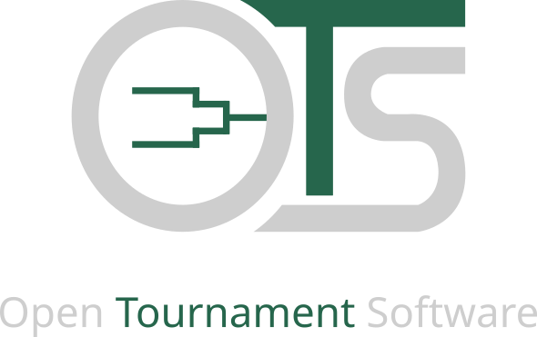

# Open Tournament Software

<h1 align="center">
  
</h1>

<br/>

## Features
- Create multiple tournaments:
  - Single elimination
  - Double elemination (planned)
  - Round robin (planned)
  - Group stage + elimination (planned)
  - Swiss system (planned)
- Add participants:
  - Add name 
  - Choose icon 
  - Choose icon color
  - Choose strength (planned)

## Demo
Open-tournament-software is avaiable at github-pages.

## Data storage
All data is stored in your browser local storage.

## Setup
Requirements: `npm`
```bash
cd app
npm i
npm run dev -- --open
```
